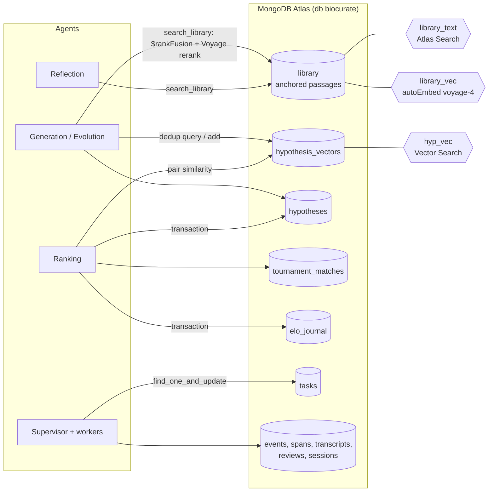

<div align="center">

# AI co-scientist

**Give it a research goal. Get back a tournament-ranked set of novel, reviewed, testable hypotheses.**

An open source re-implementation of Google's AI co-scientist
([Gottweis et al., *Nature*, 2026](https://www.nature.com/articles/s41586-026-10644-y) ·
[research blog](https://research.google/blog/accelerating-scientific-breakthroughs-with-an-ai-co-scientist/)),
in Python, running on an API key **or** on your Claude Code / Codex subscription.

[](https://github.com/Ahmad-Jaradat-Space/Co-Scientist/actions/workflows/test.yml)
[](pyproject.toml)
[](LICENSE)
[](plugin/)
[](CONTRIBUTING.md)

[Quickstart](#quickstart) ·
[How it works](#how-it-works) ·
[Built on MongoDB Atlas](#built-on-mongodb-atlas) ·
[Use it from Claude Code or Codex](#use-it-from-claude-code-or-codex) ·
[Bench results](docs/BENCH_RESULTS.md) ·
[Contributing](CONTRIBUTING.md)

</div>

---

## What it does

You write a research goal in plain language. Six specialist agents then argue
about it until something good survives:

```
co-scientist run "Identify hypotheses about microbiome-driven inflammation in Crohn's disease"
```

Generation proposes hypotheses from the literature and from simulated
scientific debate. Reflection reviews each one for novelty, correctness and
testability, then decomposes it into assumptions and checks those separately.
Ranking runs an Elo tournament of head-to-head debates. Evolution combines,
simplifies, makes feasible or reimagines the leaders, and the results re-enter
the tournament. Proximity clusters everything so near-duplicates do not waste
matches. Meta-review synthesises the whole session into a research overview.

What comes out is not a chat answer. It is a ranked leaderboard with the
reviews, the debate rationales, the citations and the full provenance behind
each entry, all in a local SQLite database you can query, or in MongoDB Atlas (see [Built on MongoDB Atlas](#built-on-mongodb-atlas)).

## Why this one

|  | What you get |
| --- | --- |
| **Faithful to the paper** | The agent roster, the prompts and the control flow follow Gottweis et al. The per-agent prompts in [`config/prompts/`](config/prompts/) come from the paper's supplement. |
| **Runs on a subscription** | Point it at `claude -p` or `codex exec` and it bills nothing per token. Structured output and citation provenance come back through a bundled MCP server. |
| **Or any model you like** | OpenRouter by default, so one key reaches 200+ models and `[models]` can give each agent a different vendor. Anthropic, OpenAI, Gemini, Groq, Together, Mistral and Ollama work directly. |
| **Durable, resumable runs** | A task queue (SQLite or Atlas) with leases, dead-lettering and resume. Kill it mid-session and `resume` picks up where it stopped. |
| **Citations you can check** | An agent may only cite a URL it actually fetched. Every evidence row carries a URL and an excerpt, and a verifier enforces both. |
| **Driveable by coding agents** | [`plugin/`](plugin/) is an Agent Plugins 1.0 package: one MCP server and seven skills that work in Claude Code, Codex CLI, Cursor, VS Code, Copilot and Kiro. |
| **Measured, not asserted** | `co-scientist bench` settles N models on one goal in a shared Elo tournament with gold-set recall scoring. Every run ever done is in [`docs/BENCH_RESULTS.md`](docs/BENCH_RESULTS.md). |
| **Tested** | ~550 offline tests, plus the same repo contract tests against Atlas when `CO_SCI_ATLAS_TESTS=1`. On the default `sqlite` backend the suite needs no key, no network and no subscription quota. |

## Built on MongoDB Atlas

Set `[storage] backend = "atlas"` and the whole system (sessions, hypotheses, the
task queue, the Elo tournament, events, the evidence library) runs on a MongoDB
Atlas cluster instead of local SQLite. SQLite stays the default.

| Atlas / Voyage feature | What it does in biocurate | Code |
| --- | --- | --- |
| **Atlas as the core store** | Every repo (sessions, hypotheses, reviews, tasks, tournaments, events, spans, transcripts, feedback, embeddings) has a SQLite and an Atlas implementation behind one dispatcher, chosen by `[storage] backend`. | [`storage/repos/`](co_scientist/storage/repos/), [`storage/atlas/`](co_scientist/storage/atlas/) |
| **Atomic task claims** | Workers claim a task with a single `find_one_and_update`; a unique partial index on `tasks.idempotency_key` makes enqueue idempotent. | [`storage/atlas/tasks.py`](co_scientist/storage/atlas/tasks.py), [`storage/atlas/indexes.py`](co_scientist/storage/atlas/indexes.py) |
| **Multi-document transaction** | An Elo update writes an `elo_journal` entry (keyed by match id) and both hypotheses' ratings in one `with_transaction`. Re-applying a match hits the duplicate key and is a no-op. | [`storage/atlas/tournaments.py`](co_scientist/storage/atlas/tournaments.py) |
| **Atlas Search** (`library_text`, `lucene.english`) | Keyword leg of library retrieval over passage `text` and paper `title`, with a `kind` filter. | [`storage/atlas/indexes.py`](co_scientist/storage/atlas/indexes.py), [`library/search.py`](co_scientist/library/search.py) |
| **Automated Embedding** (`library_vec`, `autoEmbed`, `voyage-4`) | Atlas embeds each passage on write and the query text at search time, so ingest sends no vectors. `library.embedding = "client"` switches to Voyage embeddings computed in Python. | [`storage/atlas/indexes.py`](co_scientist/storage/atlas/indexes.py) (`library_vec_definition`), [`library/ingest.py`](co_scientist/library/ingest.py) |
| **GridFS** (`attachments`, `plots` buckets) | Uploaded files and survival-plot PNGs are stored as GridFS files; metadata sits in `attachments_meta` and `analysis_reports`. SQLite keeps the same bytes in a `blobs` table. | [`storage/atlas/blobs.py`](co_scientist/storage/atlas/blobs.py), [`attachments/store.py`](co_scientist/attachments/store.py) |
| **Change streams** (`timeline`) | `GET /api/sessions/{id}/events` follows the session's timeline collection with a change stream, so a message written by any process reaches the browser live. SQLite polls instead. | [`storage/atlas/watch.py`](co_scientist/storage/atlas/watch.py), [`storage/watch.py`](co_scientist/storage/watch.py) |
| **Results as documents** | `timeline`, `attachments_meta`, `analysis_reports`, `analysis_points` and `syntheses` hold what used to be JSON and markdown files, served to the React app as JSON. | [`storage/atlas/`](co_scientist/storage/atlas/), [`web/app.py`](co_scientist/web/app.py) |
| **Session-scoped search** (`library_text_v2`, `library_vec_v2`) | Uploaded documents are indexed as library passages; the v2 indexes filter on `session_id` and `source` so a session only sees its own uploads. | [`storage/atlas/indexes.py`](co_scientist/storage/atlas/indexes.py), [`library/uploads.py`](co_scientist/library/uploads.py) |
| **Atlas Vector Search** (`hyp_vec`) | Duplicate detection when a hypothesis is generated or evolved, and Ranking's pair similarity. `dotProduct` index with a `session_id` filter; falls back to exact in-memory search while the index is building or returns too few hits. | [`vectors/atlas_store.py`](co_scientist/vectors/atlas_store.py), [`vectors/factory.py`](co_scientist/vectors/factory.py) |
| **Hybrid Search** (`$rankFusion`) | One aggregation fuses a `$search` branch and a text-query `$vectorSearch` branch (equal weights). | [`library/search.py`](co_scientist/library/search.py) (`build_hybrid_pipeline`) |
| **Voyage AI** | `voyage-3-large` embeddings for hypotheses, `voyage-4` for library autoEmbed, and `rerank-2.5` over the fused hits (skipped without a key, and the fused order is kept). | [`vectors/embedder.py`](co_scientist/vectors/embedder.py), [`library/search.py`](co_scientist/library/search.py) (`rerank`) |
| **`search_library` agent tool** | Generation, Reflection and Evolution can call it for hybrid search over the library. Inert unless the backend is `atlas`. | [`tools/builtins/library.py`](co_scientist/tools/builtins/library.py), [`tools/registry.py`](co_scientist/tools/registry.py) |

Atlas Stream Processing is not used.



### How to run on Atlas

1. In `.env` (copied from [`.env.example`](.env.example)) set `MONGODB_URI` and `VOYAGE_API_KEY`. The cluster must support Atlas Search and Vector Search; `$rankFusion` needs MongoDB 8.0+.
2. In your config TOML set:
   ```toml
   [storage]
   backend = "atlas"
   atlas_db = "biocurate"
   ```
3. `co-scientist init` connects, creates the B-tree indexes and the three search indexes (`library_text`, `library_vec`, `hyp_vec`) if missing.
4. Build an evidence library: `co-scientist library ingest "TREM2 microglia Alzheimer's" --max-papers 15`, then `co-scientist library stats` until both library indexes report `queryable=True`.
5. Check retrieval: `co-scientist library search "TREM2 and amyloid plaque compaction" --k 5` prints anchors with fused and rerank scores.
6. Run a session as usual: `co-scientist run "<goal>" --n 3 --budget-usd 2.0`, and watch it with `co-scientist serve`.

### Anchored passages

Ingest fetches open-access full text from Europe PMC (JATS XML) and splits it
into passages whose `_id` is an anchor: `PMC…#abstract.p1`, `PMC…#s2.p3` for a
paragraph, `PMC…#F2` for a figure caption. Each passage is stored with a
`url` of `https://europepmc.org/article/PMC/<pmcid>#<fragment>`, and
`search_library` returns the anchor, the URL and the passage text with every hit.

### Tests

The default `pytest` run is offline and uses SQLite. `CO_SCI_ATLAS_TESTS=1 pytest`
also runs the same repo contract tests against Atlas (plus the Atlas-only
library, vector and transaction tests), using collections under a unique test
prefix that are dropped afterwards. Without that variable the Atlas tests are skipped.

## Quickstart

```bash
git clone https://github.com/Ahmad-Jaradat-Space/Co-Scientist.git
cd Co-Scientist
python3.12 -m venv .venv && source .venv/bin/activate
pip install -e ".[dev]"

# Pick one backend.
export OPENROUTER_API_KEY=...   # one key, 200+ models
# ...or run on a subscription you already pay for, with no key at all:
claude                          # sign in to Claude Code once, then quit

co-scientist init
co-scientist doctor             # must report a ready backend

co-scientist run "Identify hypotheses about microbiome-driven inflammation" \
  --n 3 --budget-usd 2.0 --wall-clock 600

co-scientist report <session-id>    # the final research overview
co-scientist serve                  # live dashboard at localhost:7878
```

`doctor` costs nothing and tells you exactly what is missing. Run it first.

Full detail: [Install](#install) · [LLM backend](#llm-backend) ·
[Run a research session](#run-a-research-session)

## How it works

The agent roster and control flow follow the paper:

| Agent | What it does |
| --- | --- |
| **Generation** | Proposes hypotheses through literature review and simulated scientific debate. |
| **Reflection** | Reviews for novelty, correctness and testability, and deep-verifies the assumptions underneath. |
| **Ranking** | Runs an Elo tournament of simulated debates between hypotheses. |
| **Evolution** | Combines, simplifies, makes feasible, or reimagines top-ranked hypotheses out of the box. |
| **Proximity** | Embeds and clusters hypotheses to drive dedup and informative tournament pairings. |
| **Meta-review** | Synthesises system-wide feedback and writes the final research overview. |

A **Supervisor** parses the goal into a research plan and schedules agent tasks
through a durable queue (SQLite, or Atlas with atomic `find_one_and_update` claims) with bounded concurrency. It stops on
whichever comes first: budget, wall clock, Elo stability, or an idle queue.

See [Architecture](#architecture) for the full picture, including the shared
infrastructure underneath.

The source materials used to instruct the coding agent that built this came
from the paper's supplement: the pseudocode for every agent, the per-agent
prompts, and the architecture diagrams. They live in a local `reference/`
directory that is **not redistributed here**, since they belong to the paper's
authors. Get them from the
[paper's supplementary information](https://www.nature.com/articles/s41586-026-10644-y#Sec44).
The prompts as this repo uses them, with Jinja interpolation, are in
[`config/prompts/`](config/prompts/).

> This is an independent re-implementation. It is not affiliated with Google or
> with the paper's authors, and hypotheses it produces are a starting point for
> a scientist, not a finding.
>
> The codebase originates from
> [Kaimen-Inc/Co-Scientist](https://github.com/Kaimen-Inc/Co-Scientist).

## Contents

- [Architecture](#architecture)
- [Install](#install)
- [Initialize](#initialize)
- [Run a research session](#run-a-research-session)
- [LLM backend](#llm-backend)
- [Configuration](#configuration)
- [Bench: compare models head-to-head](#bench-compare-models-head-to-head)
- [Use it from Claude Code or Codex](#use-it-from-claude-code-or-codex)
- [Repository layout](#repository-layout)
- [Contributing](#contributing)
- [Citing this work](#citing-this-work)

## Architecture

```
                       co-scientist run "<goal>"
                                  │
                                  ▼
            ┌──────────────────────────────────────┐
            │            Supervisor                │  durable task queue (SQLite)
            │  • parse_goal → ResearchPlan         │  bounded concurrency
            │  • enqueue initial Generation tasks  │  lease + dead-letter + resume
            │  • main loop: claim → run → follow-up│  termination: BUDGET / WALL_CLOCK
            │  • decide_next_steps when idle       │              / ELO_STABLE / IDLE / EXTERNAL
            │  • finalize: meta-review overview    │
            └──────────────────────────────────────┘
                                  │  tasks
            ┌─────────────────────┼─────────────────────────────┐
            ▼                     ▼                             ▼
   ┌──────────────┐      ┌──────────────┐              ┌──────────────┐
   │  Generation  │ hyp  │  Reflection  │ review       │   Ranking    │
   │  literature  │─────►│  full +      │─────────────►│ pairwise vs  │──► Elo
   │  + debate    │      │  verification│              │   debate     │
   └──────────────┘      └──────────────┘              └──────────────┘
            ▲                     ▲                             │
            │                     │ informative pairings        ▼
   ┌──────────────┐      ┌──────────────┐              ┌──────────────┐
   │  Evolution   │◄─────│ Meta-review  │              │  Proximity   │
   │ combine /    │ feed │ system fdbk  │              │ FAISS embed  │
   │ simplify /   │ back │ + final      │              │ + cluster /  │
   │ feasibility /│      │ overview     │              │ dedup        │
   │ out_of_box   │      └──────────────┘              └──────────────┘
   └──────────────┘
            │
            ▼
       new hypotheses re-enter the cycle


  Shared infrastructure
  ─────────────────────
  • LLMProvider  ─ metered API (anthropic / openai / any OpenAI-compatible)
                   or subscription CLI (claude_cli `claude -p`,
                   codex_cli `codex exec`) over OAuth, no key
  • ToolRegistry ─ web_fetch + pubmed_search / arxiv_search / europe_pmc_search;
                   web_search auto-registered iff TAVILY/BRAVE key set;
                   science-skills discovered via SKILL.md frontmatter
  • MCP server   ─ record_* schemas + research tools served to the CLI backends;
                   captures structured output and URL provenance
  • TokenBudget  ─ per-agent shares + global cap; reservation released on retry
  • EventBus     ─ in-memory fan-out to SSE for the live web UI
  • FaissStore   ─ IndexFlatIP per session, asyncio-locked, atomic save/load;
                   Voyage → OpenAI → hash fallback, rebuilt on a dim change
  • SQLite       ─ sessions / hypotheses / reviews / tournament_matches /
                   elo_journal / tasks / transcripts / system_feedback /
                   embeddings_meta / spans / events / bench_* (15 tables;
                   WAL, busy_timeout, idempotent migration runner)
```

## Install

```bash
# Recommended: Python 3.11–3.13 (FAISS wheel availability).
# pymongo (for the Atlas backend) is a core dependency, nothing extra to install.
python3.12 -m venv .venv
source .venv/bin/activate
pip install -e ".[dev]"

cp .env.example .env
# Add the API key for your chosen provider — or none at all if you plan to run
# on a subscription CLI. See "LLM backend" below.
```

Then pick one of the two backend families. Either an **API key** for the
provider you want:

```bash
export OPENROUTER_API_KEY=...      # provider = "openrouter" (the default)
# or, to talk to one vendor directly:
export ANTHROPIC_API_KEY=...       # provider = "anthropic"
export OPENAI_API_KEY=...          # provider = "openai"
export GEMINI_API_KEY=...          # provider = "gemini"
```

> A stray `OPENAI_API_KEY` in your environment takes precedence over every
> OpenAI-compatible preset's own key, `OPENROUTER_API_KEY` included — it gets
> sent to OpenRouter and rejected. Unset it, or set only the preset's key.

…or a **subscription CLI** installed and signed in, with no key at all:

```bash
claude          # Claude Code — complete the subscription login once, then quit
# or
codex login     # Codex — sign in with your ChatGPT account
```

## Initialize

```bash
co-scientist init
co-scientist list
```

`init` creates `data/` (artifacts, vectors, logs) and applies migrations to `data/co_scientist.db`. The output prints which backend it found and whether it is usable — a resolvable API key for an API provider, or the CLI's version and login state for a subscription backend.

```bash
co-scientist doctor    # backend readiness + MCP handshake, no model call
```

## Run a research session

```bash
co-scientist run "Identify hypotheses about microbiome-driven inflammation" \
  --n 3 --budget-usd 2.0 --wall-clock 600
```

This kicks off Generation → Reflection → Ranking → Evolution → Meta-review under the configured backend. The Supervisor schedules tasks, the Elo tournament refines a leaderboard, and the final research overview is stored in the database as `db:syntheses/<session_id>` (read it with `co-scientist report <session_id>`, or from the web UI and `GET /api/sessions/{id}/overview`).

For data-driven research, attach the files to the session: `co-scientist run
"<goal>" --attach metadata.csv --attach mutations.csv` (repeatable; a `.zip` is
unpacked), or upload them with the web UI / `POST /api/sessions`. Accepted types
are `.csv`, `.txt`, `.pdf`, `.docx` and `.zip`; limits are under `[attachments]`
in the config. The files are stored in the database (MongoDB GridFS on Atlas),
the planning step sees a short description of each, and tabular files are
profiled by the data-analysis agent. The report, statistics and plots are stored
in the database as well; read them from `GET /api/sessions/{id}/analysis`. Nothing
is read from `./data` or written under `data/artifacts/` for a research session.
Remove old uploads with `co-scientist attachments prune --older-than DAYS [--yes]`.
See [docs/storage-integration.md](docs/storage-integration.md) and
[docs/frontend-api.md](docs/frontend-api.md).

The biomarker profiler expects a clinical table such as `patient_metadata.csv`
or `metadata.csv`; other filenames are recognized by their headers. Include
`SAMPLE_ID` (also `PATIENT_ID`, `sample`, or `id`), `DRUG` or `TREATMENT`, and
`OS_MONTHS` (also `PFS_MONTHS`, `survival_months`, or `time`). A matching event/censor
column is required: `OS_STATUS`, `PFS_STATUS`, `vital_status`, `status`, or `event`
(1 = observed event, 0 = right-censored).
Headers are case-insensitive. For alteration screening, add files with
`mutation`, `amplification`, or `deletion` in the filename, e.g. `mutations.csv`.
Each matrix has sample IDs in its first column, gene names in the remaining
headers, and binary `0`/`1` values. Sample IDs must match the clinical table.
Existing TSV and TXT layouts remain supported.

To rerun the biomarker statistics separately from a research session:

```bash
python scripts/validate_data_analysis.py --data-dir ./data \
  --reference ./data/kaplan_meier/biomarker_candidates.json \
  --output-dir ./data/validation
```

This standalone script needs no LLM, API key, or database, and reads its input from `--data-dir`. It uses lifelines Kaplan-Meier
estimates and log-rank comparisons, and embeds survival plots for the top three
distinct biomarkers in the `summary.md` it writes, with 95% confidence bands, censor marks,
and numbers at risk. It writes every eligible comparison to `statistical_tests.csv`, and `validation.json`
with field-by-field differences from the stored results. Exit code 0 means a
match; 1 means a mismatch. Omit `--reference` for a fresh analysis and optionally
repeat `--drug NAME` to choose treatment arms. See [statistical methods and validation](docs/DATA_ANALYSIS.md)
for the exact significance rule, data-handling policies, and limitations.
References generated with older statistical methods produce an expected method
mismatch; use a new Kaplan-Meier/log-rank artifact to validate the new results.

A full data-driven research session also generates a separate literature and
mechanistic synthesis after generation, review, and ranking. It is stored in the
database and read via `db:syntheses/<session_id>` (`co-scientist report
<session_id>`, `GET /api/sessions/{id}/overview`). The overview uses the recorded
literature sources and dataset results; the dataset statistics and plots are a
separate report at `GET /api/sessions/{id}/analysis`. The standalone validation
script produces the dataset report only, as files.

```bash
co-scientist serve            # FastAPI + htmx + SSE dashboard at localhost:7878
co-scientist report <id>      # print the final overview
co-scientist status <id>      # session metadata + counts
co-scientist pause <id> | resume <id> | abort <id>
co-scientist feedback <id> --kind directive --text "focus on metabolic pathways"
co-scientist doctor           # verify backend readiness and the MCP server
co-scientist estimate         # pre-flight equivalent-cost estimate
co-scientist eval [agent]     # run the rubric eval bundle (offline mode optional)
co-scientist tools list       # show every registered tool the agents can call
```

## LLM backend

Two families of backend serve the same agents, selected with `[llm] provider`:

| Family | `provider` values | Billing | Needs |
| --- | --- | --- | --- |
| **Metered API** | `openrouter` *(default)*, `anthropic`, `openai`, `gemini`/`google`, `groq`, `together`, `mistral`, `ollama`, `openai_compatible` | per token | an API key |
| **Subscription CLI** | `claude_cli`, `codex_cli` | included in a subscription you already pay for | the CLI installed and signed in |

They are fully interchangeable from the agents' point of view — the same six
agents, the same tools, the same structured-output contract. What differs is who
runs the tool-use loop, and whether tokens cost money. `[models]` is interpreted
by whichever family you pick, so switching usually means revisiting it.

### Metered API providers

Every agent talks to one provider per session. `openrouter` is the default because one key reaches every vendor's catalog, which is also the only way to give different agents different vendors in a single session. Any of the providers below works; pick whichever you have a key for.

Config is **deep-merged** over [`config/default.toml`](config/default.toml), whose `[models]` defaults are OpenRouter ids (`anthropic/claude-opus-4-7` and friends). So if you switch `provider` away from `openrouter`, override **every** key in `[models]` — any key you leave out keeps its OpenRouter default and will be sent to your new provider, which will reject it. `co-scientist doctor` and every `run` warn about ids that look like they belong to another provider, so you find out in preflight rather than at the first model call. Fill in model ids your chosen provider exposes (see the provider table below for examples per vendor):

```toml
[llm]
# Pick one. See the provider table below.
provider = "openai"   # openrouter | anthropic | openai | gemini | google | groq | together | mistral | ollama | openai_compatible

[models]
# Override ALL of these with model ids from your chosen provider.
# (Two tiers are enough: a stronger model for reasoning-heavy agents and a
#  cheaper one for the rest — set them to whatever your provider offers.)
parse_goal          = "<cheap-model>"
generation          = "<strong-model>"
reflection          = "<strong-model>"
evolution           = "<strong-model>"
ranking_pairwise    = "<cheap-model>"
ranking_debate      = "<strong-model>"
ranking_priority    = "<strong-model>"
metareview_feedback = "<cheap-model>"
metareview_final    = "<strong-model>"
classifier          = "<cheap-model>"
judge               = "<cheap-model>"
```

Providers are listed alphabetically. `openrouter` is the default, but nothing else about the system prefers it; pick whichever you have a key for.

| provider              | Endpoint                                                | API-key env var         | Example models                                            |
| --------------------- | ------------------------------------------------------- | ----------------------- | --------------------------------------------------------- |
| `anthropic`           | api.anthropic.com                                       | `ANTHROPIC_API_KEY`     | `claude-opus-4-7`, `claude-sonnet-4-6`                    |
| `gemini` / `google`   | generativelanguage.googleapis.com (OpenAI-compat)       | `GEMINI_API_KEY`        | `gemini-3-pro`, `gemini-3-flash`, `gemini-2.5-pro`        |
| `groq`                | api.groq.com                                            | `GROQ_API_KEY`          | `llama-3.3-70b-versatile`, `mixtral-8x7b-32768`           |
| `mistral`             | api.mistral.ai                                          | `MISTRAL_API_KEY`       | `mistral-large-latest`, `codestral-latest`                |
| `ollama`              | localhost:11434 — local models                          | *(none)*                | `llama3.3:70b`, `qwen2.5:32b`                             |
| `openai`              | api.openai.com                                          | `OPENAI_API_KEY`        | `gpt-5`, `gpt-4o`, `o3-mini`                              |
| `openai_compatible`   | Anything else; set `[llm.openai] base_url` explicitly   | `OPENAI_API_KEY`        | depends                                                   |
| `openrouter` *(default)* | openrouter.ai — 200+ models from every major vendor  | `OPENROUTER_API_KEY`    | `openai/gpt-5`, `google/gemini-2.5-pro`, `anthropic/claude-3.5-sonnet`, `meta-llama/llama-3.3-70b-instruct` |
| `together`            | api.together.xyz                                        | `TOGETHER_API_KEY`      | `meta-llama/Llama-3.3-70B-Instruct-Turbo`                 |

> Key precedence: for every OpenAI-compatible preset (`openrouter`, `gemini`, `groq`, `together`, `mistral`, `ollama`), `OPENAI_API_KEY` is used **first** if it's set, and the provider-specific var above is only the fallback. So if you have a stray `OPENAI_API_KEY` in your environment it will be sent to the preset's endpoint (and rejected) — unset it, or set only the provider's own key, when using a preset.

#### Gemini thinking and tool calls

Gemini 3 models attach an opaque thought signature to function calls. The
OpenAI-compatible adapter preserves provider-owned tool-call metadata, but
only the named `gemini` / `google` providers replay Gemini's documented
`extra_content` envelope with the corresponding function result. Other
response-only tool-call fields are retained for diagnostics and future
provider adapters, but are not sent to endpoints that may reject them. No
manual signature configuration is required.

Gemini's thinking level is also optional. With `thinking_level = "default"`
the request omits `reasoning_effort` and Gemini uses the selected model's
default. For this system's autonomous, multi-step literature and evaluation
work, `medium` is a sensible starting point:

```toml
[llm]
provider = "gemini"

[llm.gemini]
thinking_level = "medium"  # default | minimal | low | medium | high

[llm.gemini.thinking_by_mode]
"parse_goal" = "minimal"
"reflection.verification" = "high"
"metareview.final" = "high"
```

Per-mode entries override the global level and use the same `agent.mode` names
as model routing. These semantic levels are separate from the numeric
Anthropic `[thinking]` token budgets. Do not fabricate or edit thought
signatures; the adapter treats them as provider-owned continuation state.

Every other provider talks to exactly one vendor. For multi-vendor routing inside a single session, stay on the default `provider = "openrouter"` and let it dispatch upstream per model:

```toml
[llm]
provider = "openrouter"
[llm.openrouter]
referer = "https://your-app.example.com"   # optional, for catalog attribution
title   = "My Co-Scientist"

[models]
generation         = "openai/gpt-5"
reflection         = "anthropic/claude-3.5-sonnet"
ranking_pairwise   = "google/gemini-2.5-flash"
metareview_final   = "meta-llama/llama-3.3-70b-instruct"
```

Any per-agent model can point at any vendor — the example above just mixes four. Use whatever combination you prefer.

Cost is estimated via `co_scientist/llm/routing.py`'s `PRICE_TABLE`; unknown models match a family-hint (flash / mini / opus / sonnet / gemini / llama / mistral) so brand-new previews price sensibly. Tighten `[run] budget_usd` if running on a new model you haven't sanity-checked.

**Provider feature support.** Tool / function calling is **required** — the agent pipeline is built on it, so a provider (or `openai_compatible` endpoint) that can't do function calling won't work. The other three rows are optional vendor-specific accelerators: when a provider doesn't support one, it's transparently skipped, never an error.

| Feature                     | `anthropic` | everything else (OpenAI + all OpenAI-compatible providers) |
| --------------------------- | ----------- | ---------------------------------------------------------- |
| Tool / function call *(required)* | ✅    | ✅ native OpenAI; on other endpoints it must be supported or the run fails |
| Extended reasoning          | ✅ via numeric `[thinking]` budgets | ✅ OpenAI reasoning models use `reasoning_effort`; Gemini uses optional `[llm.gemini]` semantic levels |
| Prompt-cache breakpoints    | ✅          | ❌ (stripped before sending)                               |
| Batch API (50%-off ranking) | ✅          | ❌ (Anthropic-only; other providers run all matches synchronously) |

> For direct OpenAI and generic OpenAI-compatible endpoints, the reasoning-model check is a name heuristic ([`openai_client.py`](co_scientist/llm/openai_client.py) `_is_reasoning_model`). Model ids that do not match it still work, but do not receive a numeric `[thinking]` budget translated to `reasoning_effort`. The named Gemini provider uses its explicit semantic configuration instead.

### Subscription CLI backends

These execute every agent call through a local agent CLI running on a
subscription you already pay for. No API key is involved:

| `[llm] provider` | Drives | Auth | `[models]` values |
| --- | --- | --- | --- |
| `claude_cli` | `claude -p` (Claude Code) | OAuth login — run `claude` once | full ids (`claude-opus-4-7`) or aliases (`opus`, `sonnet`, `haiku`) |
| `codex_cli` | `codex exec` (Codex) | `codex login` (ChatGPT account) | Codex model ids your account is entitled to |

```toml
[llm]
provider = "claude_cli"

[llm.claude_cli]
binary = "claude"
timeout_seconds = 900
max_parallel = 3          # bounded by the subscription rate limit, not CPU
replace_system_prompt = true

[models]
# `--model` accepts full ids, and those are what `[thinking]` budgets and the
# price table key off — so the defaults work unchanged under this backend.
generation = "claude-opus-4-7"
ranking_pairwise = "claude-sonnet-4-6"
classifier = "claude-haiku-4-5-20251001"
```

Any `ANTHROPIC_API_KEY` / `OPENAI_API_KEY` present in your environment is
**stripped from the CLI subprocess** ([`cli_backend/base.py`](co_scientist/llm/cli_backend/base.py)
`BILLING_ENV_VARS`), so a call can never silently fall back to metered billing.
A test asserts this.

### How structured output survives without an API

The agents depend on forced tool use (`record_hypothesis`, `record_review`, …),
and headless CLIs have no `tool_choice` flag. The project ships its own MCP
server ([`co_scientist/mcp/`](co_scientist/mcp/)) that the backend launches per
call and wires in via `--mcp-config`:

- **`record_*` tools** — the schemas from [`agents/schemas.py`](co_scientist/agents/schemas.py)
  verbatim, validated at the tool boundary exactly as the API used to validate
  them, then written to a capture directory the backend reads back.
- **research tools** — the existing PubMed / arXiv / Europe PMC / web_fetch
  registry, with every result's URLs appended to a provenance log. That is what
  keeps the citation verifier's "you may only cite what you actually saw" rule
  enforceable.

`--tools ""` disables the CLI's built-in tools so every tool call flows through
that server and lands in your transcripts.

### Things worth knowing

- **The CLI runs its own agentic loop.** Under these backends `run_tool_loop`
  does not drive turns; it issues one call and reads the capture. If a call ends
  without a structured record, it retries once with the search tools removed and
  the record demanded, then raises. Under an API provider the same function
  drives the classic assistant↔tool_use↔tool_result cycle — the switch is the
  backend's `runs_own_loop` flag.
- **`--system-prompt` replaces Claude Code's default prompt.** Measured on this
  machine: a trivial call under the default prompt costs ~19k cache-creation +
  ~24k cache-read tokens of harness scaffolding; with ours it is ~1–2k. Set
  `replace_system_prompt = false` if you want the harness context back.
- **`--bare` is unusable here** — it forces `ANTHROPIC_API_KEY` auth and never
  reads OAuth, which defeats the point.
- **Rate limits are hours, not minutes.** Subscription limits clear over a
  multi-hour window, so rate-limit backoff starts at 30s and grows to 10min
  ([`llm/retry.py`](co_scientist/llm/retry.py)) instead of the seconds an API
  429 deserves.
- **`budget_usd` is not a spend gate here.** Nothing is billed per token under
  a subscription. The CLI reports an equivalent API cost per call and
  `budget_usd` caps that gauge, which still catches a runaway session. The real
  limits are `wall_clock_seconds` and `max_ideas`. Under an API provider
  `budget_usd` is real money again.
- **Codex model entitlement is a real gate.** A ChatGPT account that is not
  entitled to the model you name fails the run with
  `"model is not supported when using Codex with a ChatGPT account"`. Check
  with `co-scientist doctor` before a long run.

### Embeddings — independent of the backend

No agent CLI exposes an embedding endpoint, and Proximity/dedup needs real
semantic vectors, so embeddings always call a hosted API regardless of which
backend runs the agents:

```toml
[embeddings]
provider = "voyage"                # voyage | openai | hash
model = "voyage-3-large"
dim = 1024
```

With neither `VOYAGE_API_KEY` nor `OPENAI_API_KEY` this degrades to a local hash
embedder that catches literal token overlap but not paraphrase — sessions still
run, dedup is just weaker. Falling back from Voyage to OpenAI uses
`text-embedding-3-large` shortened to the configured `dim`, so vector width
never changes underneath an existing index. Changing `dim` yourself does
invalidate the FAISS indices under `data/vectors/`; the store detects the
mismatch and rebuilds rather than corrupting them. FAISS is what the SQLite
backend uses; with `[storage] backend = "atlas"` hypothesis vectors live in
Atlas Vector Search instead (see [Built on MongoDB Atlas](#built-on-mongodb-atlas)).

## Configuration

Layered: [`config/default.toml`](config/default.toml) → `~/.co-scientist/config.toml` → `./co-scientist.toml` → `--config <path>`. Secrets come from environment only (see [`.env.example`](.env.example)).

## Bench: compare models head-to-head

`co-scientist bench` runs the same goal under N different `(provider, model)` configurations and ranks them via a single shared Elo tournament. Each candidate independently generates hypotheses; then every candidate-pair plays `--matches` head-to-head debates, judged by ONE fixed judge model (picked separately so no candidate scores its own work).

> **For live numbers** — per-candidate Elo, the actual hypotheses each model proposed, gold-set hits, and what the data showed — see [`docs/BENCH_RESULTS.md`](docs/BENCH_RESULTS.md). It includes a headline-findings section at the top so you don't have to scroll through every bench.

### Presets

Presets come in the same two families as the backends. **API presets** route
every candidate through OpenRouter — the only way to get cross-vendor
comparison, since no agent CLI serves a third party's models — and need
`OPENROUTER_API_KEY`. **CLI presets** run on a subscription and bill nothing per
token, but can only field what those CLIs serve.

| `--preset`             | Family | What it does |
| ---                    | --- | --- |
| `paper`                | API | The paper's own baselines (Gemini 2.0 Flash Thinking → 2.0 Flash, Gemini 2.0 Pro → 2.5 Pro, OpenAI o1, plus Claude Haiku) — see [`bench/presets.py`](co_scientist/bench/presets.py) for each substitution and why |
| `paper-aml`            | API | The paper's AML drug-repurposing goal + gold-set recall scoring (strict top-3: Nanvuranlat / KIRA6 / Leflunomide) across those baselines |
| `paper-aml-vs-raw`     | API | Same, but each model runs **both** through the full pipeline AND as a single raw call — isolates the multi-agent harness's value-add |
| `frontier-aml-vs-raw`  | API | Same pipeline-vs-raw split across current frontier models (Claude Opus, GPT-5, Gemini 3 Pro/Flash) |
| `claude-aml`           | CLI | The AML goal and gold set, run across the three Claude Code tiers |
| `claude-aml-vs-raw`    | CLI | Pipeline-vs-raw split across those tiers |
| `cross-backend-aml`    | CLI | Claude Code vs Codex on the same goal. Needs both CLIs signed in **and** a ChatGPT account entitled to the Codex model |

> **Do not compare across families.** The prompts and gold sets are identical,
> but under a CLI backend the tool loop belongs to the CLI rather than to this
> repo, and the `$` column becomes a reported equivalent cost rather than real
> spend. Pick a judge in the same family as your candidates. The numbers in
> [`docs/BENCH_RESULTS.md`](docs/BENCH_RESULTS.md) came from the API presets.

```bash
# Free (subscription): score the Claude Code tiers on the paper's AML picks.
co-scientist bench --preset claude-aml --n 3 --matches 2

# Free: isolate how much the multi-agent harness actually adds.
co-scientist bench --preset claude-aml-vs-raw --n 3 --matches 2

# Free: Claude Code vs Codex, if you have both signed in.
co-scientist bench --preset cross-backend-aml --n 1

# Metered (needs OPENROUTER_API_KEY): reproduce the paper's baseline comparison.
co-scientist bench --preset paper-aml --n 3 --matches 2

# Metered: current frontier models, pipeline vs raw.
# (--budget-per-candidate defaults to 3.0; frontier models need it.)
co-scientist bench --preset frontier-aml-vs-raw --n 1
```

### Pipeline vs raw LM (one model, isolated)

The `--preset *-vs-raw` presets pit each model's **full co-scientist Generation pipeline** (literature tools + tool loop + dedup + `record_hypothesis`) against a **single raw LM call** with the same model + a forced `record_hypothesis` function call (no tools). Lets you measure how much of the system's output quality comes from the multi-agent harness vs the underlying model. → live numbers in [`docs/BENCH_RESULTS.md`](docs/BENCH_RESULTS.md#headline-findings).

### Gold-set scoring (AML drug repurposing)

The `*-aml*` presets score **recall** against a curated answer key from the Co-Scientist paper. Two gold sets ship; both stay registered so historical bench artifacts remain interpretable.

| label                                                   | size | what it is |
| ---                                                     | --- | --- |
| `aml-repurposing-paper-top3` *(default for every `*-aml*` preset)* | 3 | Top-3 of the original paper's list: candidates with no prior published AML repurposing, no prior preclinical evidence in AML, and no external inputs (no DepMap scores, no expert curation). → **Nanvuranlat (JPH-203 / KYT-0353), KIRA6, Leflunomide (Arava / HWA-486 / Teriflunomide / Aubagio)** |
| `aml-repurposing-paper-5`                               | 5 | Broader 5-drug list referenced in the paper's main text: **Binimetinib (MEK162), Pacritinib (SB1518 / Vonjo), Cerivastatin (Baycol), Pravastatin (Pravachol), Dimethyl fumarate (DMF / BG-12 / Tecfidera)** |

Swap with `--goldset`:

```bash
co-scientist bench --preset claude-aml --goldset aml-repurposing-paper-5   # broader list
co-scientist bench --preset claude-aml --goldset none                       # head-to-head only
```

The matcher is whole-token, case-insensitive, and looks at every searched field of every hypothesis (title / summary / full_text / `entities` / citation excerpts). Drug **class** mentions (e.g. "DHODH inhibitor") do **not** count — the candidate has to name the actual compound (or one of its registered aliases).

### Custom candidates

`label=provider:model[@mode]`. `mode` is `pipeline` (default) or `direct`. Pipeline goes through the full Generation agent stack; direct is a single forced-tool LM call with no literature tools.

```bash
co-scientist bench "Identify hypotheses about X" \
  -c opus=anthropic:claude-opus-5 \
  -c opus-raw=anthropic:claude-opus-5@direct \
  -c sol=openai:gpt-5.6-sol \
  -c luna=openai:gpt-5.6-luna \
  --judge anthropic:claude-sonnet-5
```

### Where results live

Every bench writes to SQLite + JSON on disk:

```
data/co_scientist.db                          ← SQLite, all metadata
  bench_runs                                  one row per bench
  bench_candidates                            one row per (bench × candidate × mode)
  bench_matches                               one row per head-to-head

data/artifacts/<session_id>/                  ← JSON on disk
  bench/<bench_id>.json                       run summary + per-entity gold_hit_detail
  hypotheses/<hyp_id>.json                    every hypothesis the bench produced
  transcripts/generation/<trn_id>.json        every LLM call
```

The auto-generated [`docs/BENCH_RESULTS.md`](docs/BENCH_RESULTS.md) (rebuild with `python scripts/build_bench_report.py`) walks every recorded bench and renders the per-candidate result table, every hypothesis attributed to the model that produced it, and a post-hoc rescore against every registered gold set.

### Mechanics

- **Generation runs in parallel** per candidate under a deep-copied Config (`cfg.llm.provider`, `cfg.models.*`, thinking budgets zeroed for non-Anthropic).
- **Round-robin pairings**: every pair plays `--matches` head-to-heads (one random hypothesis from each side per match).
- **Structured verdict** via a forced `record_verdict` function call — no fragile `better idea: <N>` text parsing across providers.
- Bench runs are **isolated from regular sessions** — they don't write to `tournament_matches` or affect any session's leaderboard.

## Use it from Claude Code or Codex

[`plugin/`](plugin/) is an [Agent Plugins 1.0](https://agent-plugins.org/specification)
directory that lets a coding agent drive the engine: one `plugin.json`, one
`mcp.json`, and seven skills. The same directory loads in Codex CLI, Claude
Code, Cursor, VS Code, GitHub Copilot and Kiro, so there is no per-client copy.

```bash
codex plugins install ./plugin                        # Codex CLI

ln -s "$PWD/plugin/skills/"* ~/.claude/skills/        # Claude Code
claude mcp add co-scientist -- co-scientist mcp-server
```

The MCP server is `co-scientist mcp-server`, defined in
[`co_scientist/mcp/session_server.py`](co_scientist/mcp/session_server.py). It
serves fifteen tools: session lifecycle (`session_start`, `resume`, `pause`,
`abort`, `status`, `list`), reading (`hypotheses_list`, `hypothesis_get`,
`overview_get`), writing (`hypothesis_record`, `review_record`, `match_record`,
`feedback_add`), and diagnostics (`estimate_cost`, `doctor`).

The design rule: the engine keeps all state, and everything an agent produces
goes back in through the same repositories the engine's own agents use. A review
written by Claude Code and a review written by the Reflection agent are the same
row in the same table, so Elo stays coherent and the meta-review sees both. The
skills carry the judgement the tools cannot: the review rubric, the debate
criteria, the four evolution operators, and the failure modes to check before
believing a ranked hypothesis.

Add `--read-only` to the server command (or `COSCI_ALLOW_START=0`) to refuse
`session_start` on shared machines, so an agent cannot spend budget on its own.

See [`plugin/README.md`](plugin/README.md) for install detail, virtualenv paths,
and how to validate a change with `python scripts/validate_plugin.py`.

## Repository layout

```
co_scientist/
  agents/       # supervisor + 6 specialized agents (base, generation, reflection,
                # ranking, evolution, proximity, metareview)
  bench/        # cross-model bench runner (Elo tournament + gold-set scoring)
  llm/          # provider abstraction (anthropic / openai / openai_compatible),
                # tool loop, token budgets, model routing, retry, batch, estimator
  mcp/          # MCP servers: per-call capture for the CLI backends, plus the
                # outward-facing session server the Agent Plugin launches
  storage/      # SQLite schema + migrations, db connection, 10 repos;
                # atlas/ = the MongoDB Atlas implementation of the same repos
  tools/        # tool registry; web_fetch, web_search, pubmed/arxiv/europe_pmc,
                # science-skills bridge
  vectors/      # embeddings (Voyage / OpenAI text-embedding-3-large / hash),
                # FAISS (SQLite) or Atlas Vector Search (Atlas)
  library/      # Europe PMC JATS ingest + hybrid search (Atlas only)
  orchestrator/ # task scheduling, Elo updates, termination, event bus
  safety/       # injection quoting, classifier, citation verifier
  obs/          # metrics (tokens, cost, cache hit ratio, latency)
  web/          # FastAPI + htmx + SSE UI + sanitized markdown renderer
  evals/        # per-agent + e2e + regression evals
  tests/        # ~550 offline tests (Atlas tests gated by CO_SCI_ATLAS_TESTS=1) + fixtures + smoke
config/
  default.toml
  prompts/      # 14 Jinja2 templates (one per agent.mode), derived from
                # the paper's supplementary prompts
docs/
  BENCH_RESULTS.md   # every bench ever run (auto-generated)
plugin/         # Agent Plugins 1.0 package: plugin.json, mcp.json, 7 skills
                # loadable by Claude Code, Codex CLI, Cursor, VS Code, Copilot
scripts/
  build_bench_report.py
  validate_plugin.py # spec conformance check for plugin/
reference/      # paper source materials (pseudocode, prompts, diagrams)
data/           # gitignored; runtime artifacts (SQLite, FAISS, transcripts)
vendor/         # gitignored; pinned clone of google-deepmind/science-skills
```

## Contributing

Pull requests welcome. [`CONTRIBUTING.md`](CONTRIBUTING.md) covers the setup,
what a good change looks like, and the three commands CI runs:

```bash
ruff check co_scientist scripts
pytest co_scientist/tests/unit -q
python scripts/validate_plugin.py
```

Every unit test runs offline, so you can work on this without a key.

Security issues go through
[private advisories](https://github.com/Ahmad-Jaradat-Space/Co-Scientist/security/advisories/new),
not public issues. See [`SECURITY.md`](SECURITY.md).

## Citing this work

If this repository is useful in published work, cite the paper it
re-implements, and the repository if the implementation itself mattered.
[`CITATION.cff`](CITATION.cff) has both in machine-readable form, and GitHub
renders a ready-made citation from it in the sidebar.

```bibtex
@article{gottweis2026coscientist,
  title   = {Towards an AI co-scientist},
  author  = {Gottweis, Juraj and others},
  journal = {Nature},
  year    = {2026},
  doi     = {10.1038/s41586-026-10644-y}
}
```

## License

Apache-2.0. See [`LICENSE`](LICENSE).

The paper, its prompts and its diagrams belong to their authors. This
re-implementation is independent and unaffiliated.
